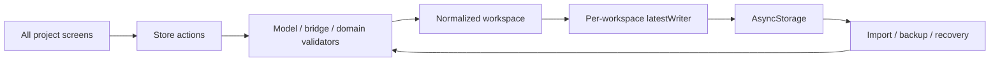

# Milvayo cloud baseline — 0.8.3 → build 0.8.4

Baseline supplied by the owner: **0.8.3**. Target build: **0.8.4**, already synchronized in package.json, package-lock.json and app.json. Existing 0.8.4 Web chart fixes remain. Work is in place on `work`; no automatic commit, merge, push, deployment or login. Pre-existing deleted/untracked handoffs and ZIPs are unrelated and preserved.

## Source audit

App.js → src/app/App.js → ModernApp.js. Expo 58.0.23, React Native 0.88.1, React 19.3.0. Metro configuration is unchanged. Navigation uses sections.cjs and retained/frozen primary screens. StoreProvider owns workspaces, stable action contexts, normalization and per-workspace latestWriter. Every normal edit uses trans → projectChange/safeMutation → bridge.reconcile → model validation → activity → put → AsyncStorage. Workspace switching flushes the old writer and changes an epoch. Imports and recovery validate before replacement.

AsyncStorage keys: `milvayo-v1` for main; `niyarvo-workspace-v1:<id>` for other workspaces; `niyarvo-workspaces-v1` for the index. Workspace schemaVersion remains **1**, independently of app/cloud versions. JSON/niyav backups, snapshot budgets, encrypted export, duplicate-project rehoming and recoverable local history remain authoritative.

## Persistent inventory and mutation map

Workspace: projects, portfolios, programs, selectedId, activity, revision and local recovery backups. Project: tasks, boards/lists, Kanban preferences, resources, timeEntries, comments, reminders, budget, governance info/budget lines/risks/WBS/docs, tools, powerUps, labels, task schema/types/fields/transitions, scheduling calendar/typed links, phases, releases, sprints (including frozen histories), savedViews, automation commands/history/rules, schemas, API contracts, playbooks, changelog and canvases.

Tasks embed tests, attachments (currently external URLs), labels, dependency IDs, custom values and Git evidence. Projects are independently addressable; program/portfolio organization is not an authorization grant. Task IDs may repeat across imported projects. Owner/resource names are labels, not authenticated identities.

Board, Timeline, List, Sprints, Releases/Testing, Resources/Costs, Collaboration, Scheduling, Task Configuration, Specifications, Projects/Programs/Portfolios, reports and activity all consume the shared workspace. Governance has a projection adapter over the same StoreProvider, not another database. Appearance/diagnostic preferences and transient camera/gesture/editor state are separate.

Multi-record edits: dependency scheduling/invalidation; Kanban reindexing/automation; parent moves/deletion; release/sprint changes; project/template copy and import; resource removal; program/portfolio links; snapshot restore; Canvas groups, connectors and anchored comment removal. These need an atomic cloud mutation, not independently acknowledged child writes.

## Canvas

Canvas is a vector planning editor, not a bitmap or generic task board. Project canvases contain metadata, viewport, objects (notes/text/shapes/cards/frames/freehand/linked diagrams), connectors and anchored threads/messages. References support live canonical projections and frozen snapshots. Sources do not own canonical task/schedule data. Platform pairs handle camera/gestures; previews remain local until committed. saveCanvas and canvasStorage enforce expected board revisions, 1.4 MiB live workspace budget, archive-before-delete and recovery. Limits: 1,000 objects, 2,000 connectors and 1,000 threads per board; native thousands-of-elements claims would contradict current limits. Existing Canvas ownerId is a local sentinel and grants are rejected: it must never be interpreted as Firebase authorization.

## Environment and baseline

Android ARM64 PRoot, Node 24.21.0, npm 12.2.0, Java 21.0.13, Firebase CLI 15.34.2. Approximately 3.8 GiB available memory / 116 GiB free disk at audit; changing host measurements, not production sizing. Baseline `npm test`: **984 passed, 0 failed, 0 skipped**, 87.9 s. Full output: docs/qa/cloud-084/baseline-tests.txt.

## Controlled scope and risks

Add an emulator-only adapter, scoped durable sidecar journal, granular cloud records, server authorization/domain validation, denied direct privileged writes, rules tests and bounded synthetic benchmarks. No store rewrite, automatic workspace import, schemaVersion bump, Metro edits or production credentials. Keep original local copies and export before connecting. Cloud hydration validates complete candidate state before a local replace. Account/org/workspace keys cannot be reused across scopes. Permission revocation halts sync and drops cloud caches; existing user-owned local exports cannot be remotely recalled.

Security and model consistency come before cloud UI. Whole-project validation may require broader server reads; measure and report those reads. Emulators cannot certify production billing, IAM, PITR, background mobile execution or physical frame rates.

## Before UI audit and direction

Exact workflow: Settings → explicit local Firebase session/connection, organization and platform administration. Existing Settings uses themed Page/Card/Fold/Input/Button and Backup; preserve it. Source review only at baseline; runtime visual acceptance pending.

Spacing → existing 12/16/24 rhythm, new forms wrap on phones. Color → existing neutral chrome and selected accent; no new palette. Icons → existing Feather only where useful. Copy → name emulator/simulated states and explicit operations. Typography → existing T hierarchy, readable IDs that wrap. Layout → bounded Settings folds, no added navigation entry. Details → labelled fields, disabled busy actions, retained errors. Visuals → measured counters only; no invented charts. Motion → no decorative motion.

Product: precise project workspace with explicit local cloud collaboration.
Character: calm, exact, dependable.
World: planning instruments and quiet technical workbenches.
Moments: Gantt, Kanban, Canvas and verified progress remain the rich content.
Signature: selected accent (default clay orange), meaningful statuses, Milvayo Board mark.

Review standard: bundled Unslop by **Damir Sokolovsky**, CC BY 4.0, `.opencode/skills/unslop/SKILL.md` and signs/tokens references. This is a review standard, not a rebrand.

Live Web follow-up: at 390 px in the existing desktop layout, the shared header search input retained a 174 px intrinsic minimum and extended the page to 445 px. Restrict the patch to allowing both header search inputs to shrink (`minWidth: 0`, `flexShrink: 1`). Preserve the shell, controls, type, colors and motion. Validate actual overflow again in Chromium.

Live connection workflow follow-up: opening a different project remounts Settings under the established project key. Keep the emulator fold initially open while its stable session is connected/connecting, and disable duplicate connection actions while that session is busy. Preserve the existing screen key/navigation behavior.

Web accessibility follow-up: the installed react-native-web DOM adapter does not map accessibilityState.expanded. Add an explicit Web aria-expanded value to the existing Fold button; preserve its native accessibilityState and interactions. This also makes live automation observe the real open/closed state instead of accidentally closing an already-open connection panel.

## Before-audit for the completed collaboration/administration patch

Exact workflows: Collaboration's task/project conversation, watcher and mention notifications; Settings organization structure, seat allocations, platform operations/configuration; and restoring a large backup into a fresh staged workspace. Existing Collaboration renders local comments/reminders and explicitly says messaging is disconnected. Keep those local records and their import format; add authenticated cloud records separately, with project permission checks and export/recovery coverage. Teams/departments are organizational relationships only, never implicit access.

Before-audit: spacing → reuse existing folds and 12/16 gaps; color → neutral surfaces and selected accent; icons → existing controls only; copy → explicitly distinguish pending messages, simulated seats and local configuration; typography → existing T/Input hierarchy; layout → append optional connected-only folds, no navigation changes; details → bounded pages, retained drafts/errors, explicit destructive confirmation; visuals → actual counts and messages; motion → existing fold/press behavior only. The five-line product direction above is unchanged.

Controlled model scope: separately authorized cloud collections, durable message operations in the existing journal, permission-filtered notifications containing pointers only, bounded transactional fan-out, scoped organization structure/seat pools, and fresh-workspace staging for large restores. Preserve local schemaVersion 1; retain support for existing cloud v1 backups while adding a versioned cloud export envelope for collaboration content. No dependency or Metro changes.

Completion evidence: the scoped collaboration/administration/recovery patch above is implemented. Final automated, Web runtime, benchmark and remaining device/production gates are recorded in `docs/qa/cloud-084/REPORT.md`.
