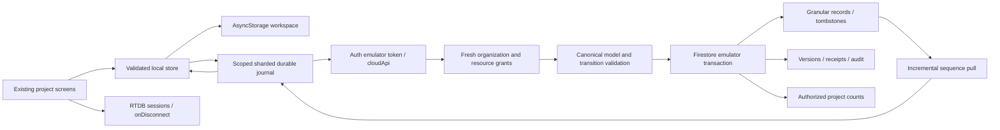

# Emulator cloud architecture — build 0.8.4

Baseline 0.8.3; existing 0.8.4 chart correction retained. This is a local integration, not a production deployment. Configuration accepts only demo-milvayo-083 and localhost/private IPv4 hosts. The server requires all four Admin SDK emulator environment variables and FUNCTIONS_EMULATOR=true. No Firebase login, live project, payment request or deployment was performed.

The Firebase JS SDK supports Expo Go; the integration uses memory-only SDK caches and an explicit AsyncStorage journal instead of assuming IndexedDB is available on native. Authentication is deliberately in memory: sign in again after restart. SDKs are connected to emulators before operations. See [Expo Firebase guidance](https://docs.expo.dev/guides/using-firebase/) and [Firebase supported environments](https://firebase.google.com/docs/web/environments-js-sdk).

Client modules live in src/cloud; trusted HTTP operations in src/cloud/server; operational tools in src/cloud/tools. Functions source references the existing domain modules outside its local source directory. This works locally; a reviewed production packaging step is still required. No Metro config was changed.

Each domain put is journaled, including committed Canvas changes; local writer coalescing does not collapse cloud operation boundaries. Local work is retained if cloud persistence fails. The cloud queue is separate from schemaVersion 1 backups. Explicit imports are staged, resumable and hidden until canonical validation plus a source checksum pass.

Do not infer production scaling from this implementation. A workspace sequence document serializes consistency, and validation reads all records in the affected project (workspace-wide for structural edits). This is a measured correctness-first bottleneck, documented in the risk register.

## v0.8.5 implementation

Independent existing-task edits use a bounded point-read validator (six reads; seven for custom configuration), with compact field patches and five steady writes. Structural/workflow/bulk/recovery operations retain the canonical validator. Count summaries skip unrelated edits. Durable task drafts and explicit Save consolidate compatible unsent mutations; fixed sent payloads replay verbatim across upgrades. The workspace sequence remains central and is a measured contention limit. See [085 mutation analysis](../qa/cloud-085/mutation-analysis.md) and [readiness](../qa/cloud-085/privacy-and-readiness.md).
