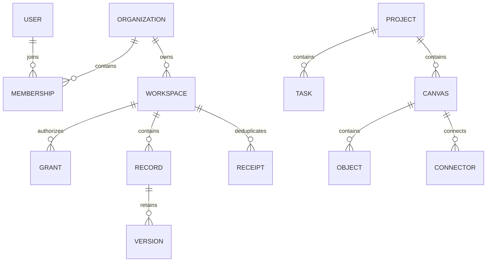

# Database schema

Cloud schema 1 is independent of application 0.8.4 and local workspace schemaVersion 1.

| Path | Meaning / authority |
| --- | --- |
| users/uid | Private organization index; only self may read |
| platformRoles/uid | Separately bootstrapped service role; no customer-content access |
| orgs/org | Organization name and owner metadata |
| orgs/org/members/uid | Active organization membership and administrative role |
| orgs/org/subscription/current | Simulated capacity and unique seat UIDs; server-only |
| orgs/org/invitations/hash | Target UID, scoped grant, expiry and one-use state |
| orgs/org/workspaces/ws | Import state, checksum, creation generation, sequence |
| …/grants/uid | Workspace default role plus per-project overrides and version |
| …/records/key | Independently updated canonical entity envelope |
| …/versions/key@revision | Immutable record version, actor and event time |
| …/receipts/mutation | Idempotent result and payload hash, scoped to actor |
| …/audit/event | Append-only operation metadata |
| …/summaries/project | Incremental task/status/Canvas counts |
| orgs/org/teams/id, departments/id | Bounded organization structure; no implicit content grants |
| orgs/org/seatAllocations/hash | Resource cap and member UID allocation; global seats remain unique |
| orgs/org/adminAudit/id, settings/retention | Audited administration and configured-only retention policy |
| …/messages/id, conversations/hash | Immutable messages and transactionally sequenced thread metadata |
| …/watchers/hash | Project/thread/user relationship requiring legitimate read access |
| …/notifications/hash | Recipient UID and conversation/message pointers; no message body |
| platform/config, platformAudit/id | Local feature/release configuration and protected audit |
| orgs/org/billingEvents/id | Audited, signed simulated payment event |

An envelope contains key, kind, projectId, boardId, original id, data, order, schema, revision, sequence and deleted. Example: kind=tasks, projectId=synthetic-83-0, id=task-0, boardId="", revision=2, sequence=2. The key URI-encodes the family and scope; it is not an authorization grant. Original IDs are preserved. Imported projects may contain identical task IDs, so project scope disambiguates physical record keys. Moving across scopes requires an atomic remove/add with the original logical ID, not an undocumented rename.

Families follow actual source: project metadata; tasks, boards, resources, time entries, comments, reminders, phases, releases, sprints, saved views, automation records, specifications and project history; separate governance WBS/risks/budget-lines/docs and typed dependencies; portfolio/program records; Canvas metadata, objects, connectors and threads. Embedded task tests/attachments/custom values stay inside their task. Sprint history stays inside its sprint; Canvas replies stay inside their thread. Large text and arrays are conflict units, not a CRDT.

Local selection, recovery snapshots, activity and device preferences are not uploaded as one workspace blob. Existing local exports remain unchanged. Object/array order is explicit, and dependency/model round trips are validated. Document payloads are capped at 400 KB UTF-8; requests at 900 KB. Atomic mutations contain at most 100 record changes. Oversized operations fail visibly and retain local work. Firestore data maps are excluded from automatic indexing; indexes cover project-scoped sequence queries. Conversation pages are limited to 50 messages; directory pages to 100 members and notification pages to 100 pointers. Local bounds are 20 workspaces per organization, 100 teams/departments per family, 100 watchers per conversation and 200 allocation scopes per person. Cloud imports use at most 100 rows / 650 KB per request. Emulator queries do not prove production composite-index acceptance.
