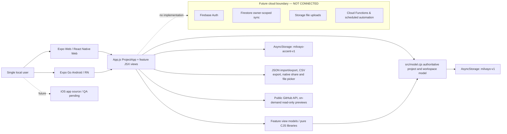
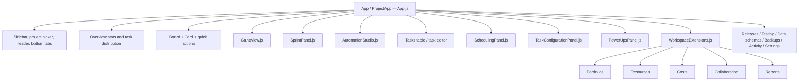
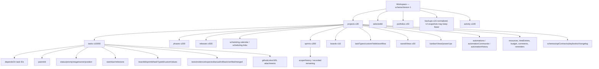
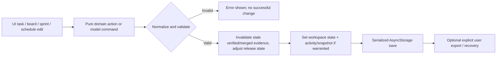

# Milvayo v0.3.12 — architecture and data maps

## 1. Product and deployment architecture (as delivered)

**Actual stack in `package.json`:** `expo ~58.0.20`, `react-native 0.88.1`, `react 19.3.0`, `react-native-web ^0.21.0`, `@react-native-async-storage/async-storage 2.2.0`, `react-native-svg 15.16.0`, `react-native-safe-area-context ~5.10.1`, `expo-file-system ~58.0.11`, `expo-document-picker ~58.0.4`, `expo-sharing ~58.0.21`; icon and Expo runtime dependencies. `package.json` has no nonempty devDependencies.

**Build/run:** `npx expo start` (Metro and Fast Refresh), `npm test` (Node native test runner); `npx expo export --platform web --output-dir dist` produces static Web build when intentionally exporting; `scripts/deploy-hosting.cjs` is a guarded Hosting-only script, not authentication/sync. No APK or iOS binary is bundled; the user creates builds independently.

**Security boundary:** Firebase configuration files are *scaffold*, not active synchronization. `firestore.rules` and `storage.rules` are DENY-ALL. No Firebase JS SDK dependency in the package. Public GitHub API use is unauthenticated and read-only. Not a multiuser server.

## 2. UI composition and route map

`App.js` is a large shared React Native/React Native Web module (~115 KB). `App` wraps `ProjectApp` in `SafeAreaProvider`. `ProjectApp` owns selected project, current screen, task draft/editor, modals, status feedback, workspace updates and JSON persistence. The application does **not** use an Expo Router file-routing tree; navigation is an in-component `tab` state and `screens` map. Sidebar is visible on wider screens; on narrow screens, the mobile bottom bar has Overview / Board / Timeline / Sprints / Tasks and a scrollable in-tree navigation drawer exposes the remaining screens.

**Navigation names exactly as source:** `Overview`, `Board`, `Timeline`, `Sprints`, `Tasks`, `Automations`, `Releases`, `Testing`, `Data schemas`, `Backups`, `Activity`, `Portfolios`, `Resources`, `Costs`, `Collaboration`, `Reports`, `Settings` (17 screen labels). `src/BrandMark.js` is the Android/iOS SVG mark, `src/BrandMark.web.js` is the browser-native SVG mark introduced to avoid a Web `react-native-svg` adapter error. `src/theme.cjs` defines ten accents; `src/design.cjs` maps shared colors/spacing/touch targets.

**Known UI debt:** `App.js` is monolithic; a clean feature/component extraction is desirable only after snapshot-based regression coverage. Unslop skill and `AGENTS.md` govern UI changes; preserve dark neutral graphite design, accent defaults, semantic colors, usable mobile touch targets and existing gestures.

## 3. Domain modules and ownership

| Module | Responsibility and authoritative operations | Implications |
|---|---|---|
| `src/model.cjs` | `makeProject`, `defaultTask`, `createWorkspace`, `normalizeWorkspace`, `validateProject`, `importProject`, `moveTask`, dependency mutation, task/parent deletion, archive/restore/select, snapshot/restore, verification/release readiness, public module aggregation. | **Central normalization/validation gate.** Import format `niyarvo.project.v1`; enforce here before persistence. |
| `src/taskSchema.cjs` | Per-project task type definitions, custom typed field definitions/values, optional allowed status transition matrix. | New fields and status transitions must remain backward-compatible. |
| `src/taskWorkflows.cjs` | Hierarchy/descendant validation, task filtering/search/paging and all-or-nothing bulk edits. | Prevent cycles and excessive depth; preserve children on parent delete. |
| `src/planning.cjs` | Leaf-progress and effort rollups; saved task view normalization/filter/query; planning updates with verification invalidation. | Parent progress is derived, not double counted. |
| `src/boards.cjs` | Protected Main board, additional named boards, member assignment, safe deletion/reassignment, board validation. | **Board membership and workflow status are independent.** All boards presently share four statuses. |
| `src/kanbanUX.cjs` | Card filters/date buckets, visibility-aware drop index, per-board description view, safe duplication and label operations. | Filter results must not change underlying membership or silently reorder hidden cards. |
| `src/automation.cjs` | Advanced multi-action automation normalization, validation, event matching, bounded execution, local audit history and due-run idempotency. | No unattended time trigger; avoid loops and bypass of release rules. |
| `src/powerUps.cjs` | Built-in board Power-Up opt-in registry, safe GitHub URL parsing, GitHub link metadata/public previews, calendar/aging helpers. | Not a Trello extension runtime; no API token storage, private repo authorization or GitHub write support. |
| `src/agile.cjs` | Sprint create/assign/start/snapshot/finish/delete; observed burndown and historical sprint summary. | One active sprint per project; don't synthesize historical events. |
| `src/scheduling.cjs` | Pure calendar/FS/SS/FF/SF relationship logic; signed lag; audit, read-only preview, explicit cascade apply. | Independently unit tested. |
| `src/scheduleProject.cjs` | Per-project typed-link metadata, calendar normalization, graph reconciliation and safe apply/verification invalidation. | `task.dependsOn` remains synchronized with typed link metadata. |
| `src/gantt.cjs` | Gantt date geometry, rows, hierarchical summary bars, dependency curves, milestone layout, FS-only critical-path estimate. | Critical-path estimate must be disabled for unsupported typed calendars/relations. |
| `src/gantt-window.cjs` | Selects viewport-visible Gantt rows/day columns/link geometries. | Prevents enormous SVG allocation on Android. |
| `src/viewport.cjs` | Zoom/pinch/scroll and coordinate helpers. | Preserve pointer anchor and scroll bounds. |
| `src/operations.cjs` | Resource rates/capacity, time entries, budget & cost, comments, reminders, portfolios, health, sprint velocity, safe CSV, project templating. | Local single-user estimates, not complete finance/collaboration suite. |
| `src/importFiles.cjs` | Native file picker/read strategies, 5MB cap, user-facing error mapping. | Expo SDK 58 Android file access uses system-granted direct handle. |
| `src/theme.cjs`, `src/design.cjs` | Persistent accent configuration and UI tokens. | Stored accent separate from portable project data. |

All `.cjs` domain files use CommonJS and are testable directly in Node, while `.js` JSX components implement platform UI. Keep domain behavior in pure modules; keep UI side effects in React/hooks and import/share boundaries.

## 4. Object/data map

### Key persisted values (actual source)

- **Workspace storage:** `AsyncStorage['milvayo-v1']` serialized JSON; writes queued in `saveQueue` to preserve order. `normalizeWorkspace()` reads it on start. On read failure, the app enters a **non-destructive recovery screen**, not a blank reset.
- **Theme storage:** `AsyncStorage['milvayo-accent-v1']`, default orange `#D97757`; name choices Aqua, Mint, Lime, Amber, Orange, Coral, Pink, Fuchsia, Violet, Indigo.
- **Single project import/export:** root `format: 'niyarvo.project.v1'`; normalization via `importProject` and `makeProject` before inclusion in workspace. `version` is user-defined project metadata, not necessarily the running application version.
- **Workspace snapshot:** covers project collections and activity/backup data as handled by `workspaceSnapshot` and `restoreSnapshot`; destructive operations may save a restore point. In-app snapshots are still stored in the local browser/app environment; **export actual JSON files to a safe external location**.
- **Validation caps visible in source:** max 30 projects, 10,000 tasks/project, 16 boards/project, 200 sprints/project, 50 saved task views, 50 portfolios/workspace, task `dependsOn` up to 100, labels up to 30, tests/checks up to 250; import max 5 MiB in `src/importFiles.cjs`. These are implementation constraints, not proven efficient performance targets.
- **Project scheduling:** legacy `task.dependsOn` IDs plus `project.scheduling.links` for typed constraints and lag; `project.scheduling.calendar` for weekdays/exceptions. FS/0 is the legacy default. Link edits and date cascades may reopen verification and release testing.
- **Task progress:** status Done contributes 100%; unfinished leaves contribute manual 0–100, weighted by positive `estimateHours` or unit weight; parents are computed from leaves, not persisted aggregates.
- **Sprint data:** `project.sprints` plus `task.sprintId`, with lifecycle `planned`/`active`/`completed`, recorded `history` and final scope. Daily chart plots actual recorded events and ideal interpolation—not fabricated backfill.
- **Power-Ups:** `project.powerUps[boardId]`, task `githubLinks`; on-demand unauthenticated public GitHub metadata; canonical `https://github.com` URLs only.
- **Card metadata:** text/title, description, priority, stage, assignee, labels, dates, test checks, dependencies, verification evidence, GitHub refs, attachment URLs, board/sprint/custom fields.

## 5. Core invariants and mutation workflow

1. Reject duplicate task/project IDs, missing dependency targets, dependency cycles, invalid hierarchy and malformed typed relationships.
2. `Done` is subject to predecessor blockers; optional custom transition enforcement checks status moves. Verification and releases require explicit passing checks/evidence and Git SHA metadata when recording merge. **Recording SHA is not an actual Git operation.**
3. Date/effort/hierarchy/dependency changes affecting readiness clear stale `verified`/`merged` flags and can send affected releases back to `Testing`.
4. Gantt `Preview cascade` is read-only; `Apply` must be explicit, verify revision freshness and write a recovery snapshot. Scheduling is not a silent background rescheduler.
5. Board membership does not change status. Deleting additional boards rehomes their tasks to Main. Main is protected.
6. Sprint completion preserves observed history and returns incomplete work to an unassigned backlog without falsely marking it Done.
7. Local automations are explicit and bounded; no action can be presented as server-side execution. Status-based legacy rules and advanced commands coexist.
8. Project import must not mutate the user's workspace before validation/confirmation. Never overwrite sensitive local app storage when parse/read fails.

## 6. Import/export architecture, schema caveat

The JSON Schema file `schemas/niyarvo.project.v1.schema.json` is **not fully synchronized with the current runtime model**. Audited schema properties omit several present runtime fields, including root `sprints`, `kanbanViews`, `taskTypes`, `customFields`, `workflow`, and task `boardId`, `sprintId`, `taskTypeId`, `customValues` (check latest schema before future edits). The schema currently leaves `additionalProperties` unspecified rather than explicitly forbidding them; it is therefore an incomplete *documentary schema*, not a substitute for `src/model.cjs`'s normalization and validation. **Priority technical debt:** update schema definitions and add round-trip schema tests while preserving `niyarvo.project.v1` compatibility. Do not “fix” by silently dropping new fields.

## 7. Git, branching and environments

- GitHub repository known from handoff context: `zouhairelayni/Milvayo` (verify actual remote in Termux with `git remote -v`). User uses `work` for testing and `main` for user-accepted checkpoints, not automatically updated by assistant.
- No claim of which SHA contains v0.3.12. The provided archive contains no `.git` history, and no production deploy is evidenced.
- Android and Web are developed via Metro/Fast Refresh with `npx expo start` on Termux; don't switch the daily workflow to static Python hosting.
- Existing Hosting config sets SPA rewrite and basic headers, but **hosting config is not an active backend or proof of Web deployment**.
- Project data is local to the installation/browser origin; Expo Go and Web localhost do not inherently share databases or backups.
- Keep Milvayo backend and account boundaries isolated from RIVNA and Niyarvo Control Center.
