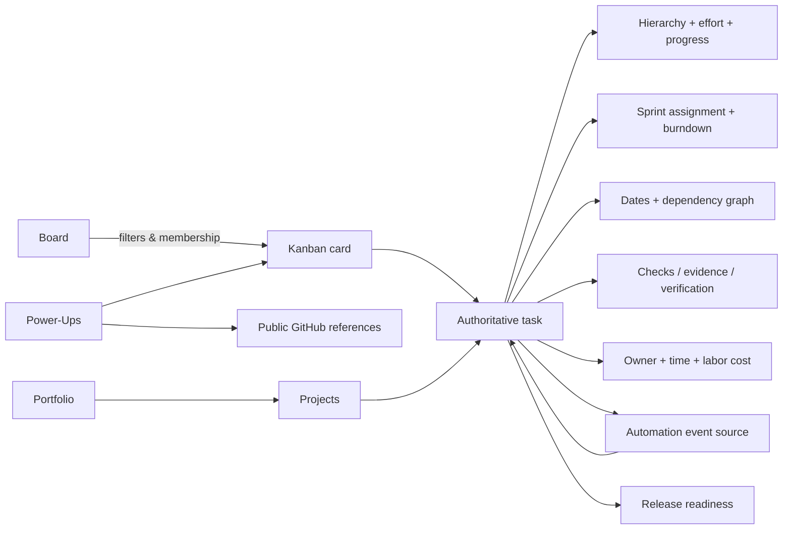

# Milvayo v0.3.12 — complete functionality map

**Legend:** **S** = implemented in audited v0.3.12 source, covered to some degree by Node tests. **F** = source implemented and *directly evidenced* in user screenshots or a targeted successful user report (not full regression). **Q** = source implemented but current version requires Android/Web interaction QA. **P** = partial/limited local capability. **N** = not implemented. **Future** refers to roadmap, not a promised delivery.

## A. User-facing navigation (17 screens)

| Screen | Current source features | Status | Limits / next improvements |
|---|---|---|---|
| **Overview** | Task counts across Backlog/In progress/Validation/Done, weighted work progress, passed checks/evidence, verification/merged counts, release readiness indication, task and stage distribution charts. | **S/F** | Duplicate embedded board removed v0.3.2-HOTFIX3. KPIs are single-project, local, not real-time team metrics. |
| **Board** | Up to 16 per-project boards; protected Main; four status lanes per board; independent-height columns; 340ms full-card hold-to-drag, same-lane ordering, edge scroll; incremental mobile cards; add card in lane; compact card metadata; advanced search/owner/priority/label/due filters; toggle descriptions; ellipsis action menu; duplicate/assign board/change status; Power-Ups. | **Q (v0.3.12)** | Four global status lanes, not freely defined Kan lists; test ellipsis versus hold-drag/filtered reorder on device; no native real-time collaboration. |
| **Timeline** | React Native SVG Gantt, date ruler, days/weeks/months, zoom/pinch, Today, earlier/later, Status/Stage/Tree, parent summary bars/progress, milestones, task bar move/resize, linking/unlinking/curve routing, critical path when supported, scheduling preview/apply. Viewport clipping for large projects. | **S/F, QA important** | Drag/resize/pinch + native performance require device acceptance; legacy critical path is not typed-calendar CPM. |
| **Sprints** | Plan/create sprint with goal and dates, assign/remove tasks, start one active sprint, finish with preserved scope/history, backlog reconciliation; completion ratios and recorded-vs-ideal burndown. | **S/F** | Historical charts cannot invent events; completed velocity shown under Reports. No multiuser sprint ceremonies or remote notifications. |
| **Tasks** | Search, statuses/priorities, saved views/sorting, progressive 40-row pages, select-visible and bulk operations, hierarchy, task types, custom fields, progress/effort, verification, detailed task drawer. | **S/Q** | Source fixes React Native raw text in custom fields since v0.3.9; ensure device test. Not a fully virtualized million-row grid. |
| **Automations** | Legacy status automation plus advanced visual studio: typed triggers, ≤8 actions, card/board buttons, manual due-date sweep, per-board/priority scope, enable/disable, local execution history. | **S/Q** | Not unattended scheduling, cloud execution or integrations; no webhook/email. |
| **Releases** | Planned/Testing/Ready/Released records, repo/version fields, linked tasks, gate/status checks, merge SHA metadata, downgrade to Testing after invalidating changes. | **S** | Does not create Git releases or validate remote commit SHA; source records only. |
| **Testing** | Acceptance checks (`pending/passed/failed/blocked`), required evidence, task-level expected/actual/rollback, verification and merge readiness. | **S** | User-supplied evidence only; does not run CI automatically. |
| **Data schemas** | Project-held schemas, API contract descriptions and playbooks/document content. | **S** | Documentation records, not database migrations/schema registry service. |
| **Backups** | Local recovery snapshots; export project JSON, export full workspace, import JSON via system picker or Web; restore snapshots. | **S/F** | In-app snapshots are local and can be lost; 5MB selected-file import cap; manual external backups essential. |
| **Activity** | Local workspace action history with bounded retention. | **S** | Not a complete immutable collaborative audit log. |
| **Portfolios** | Create portfolio groups, link projects, overview project health/overdue/blocked progress; manually set project status. | **S/Q** | Local groups only, up to 50 portfolios; no program/enterprise permissions. |
| **Resources** | Contributor records, weekly hours, hourly rates, time logs linked to tasks, assigned effort/capacity estimate. | **S/Q** | One-week simple load estimate, not per-day allocations or leveling. |
| **Costs** | Project budget/currency, planned labor estimate from owner rates, recorded labor actual, remaining budget. | **S/Q** | Not invoices, purchase orders, multi-currency conversions or accounting. |
| **Collaboration** | Task-scoped local comments and dated reminders; add/delete/complete. | **P/Q** | No chat, mentions, sharing, push or remote alert. |
| **Reports** | Sprint velocity, tasks/time CSV, clean project template duplication and reports. | **S/Q** | No PDF/executive dashboard export, server analytics, long-term trend prediction. |
| **Settings** | Project creation/manage/archive/delete; independent task types, custom fields and workflow transitions; ten accent colors with orange default; other local configuration. | **S/F for navigation** | Theme selection is per installation, not a project JSON property; no cloud account settings. |

## B. Functional domain inventory

| Area | Implemented sub-capabilities and conditions | Coverage |
|---|---|---|
| **Project & workspace** | Create, select, rename/edit, archive/restore, delete with snapshots, up to 30 projects, activity/recovery. | Local complete / cloud N |
| **Project data portability** | Portable `niyarvo.project.v1` files; workspace backups and imports; strict import model; Atlas demo fixture; CSV tasks and time export; Android picker fix. | Local complete / external sync N |
| **Kanban data model** | Board identity separate from status, Main board, create/rename/delete additional boards, rehome tasks to Main, membership persistence. | S |
| **Kanban layout** | Non-stretched columns, horizontally scrolling lanes, incremental cards, card touch drag and hover/preview, compact metadata, assignee initials and labels. | S; v0.3.12 touch Q |
| **Card actions** | Tap to open task details, ellipsis sheet, duplicate with safe reset, status change, board move, add/remove labels, execute local buttons. | S; interaction Q |
| **Kanban filters** | Text, owner, priority, labels; due none/overdue/today/tomorrow/week/month; per-board description toggle. | S; filters do not remove tasks |
| **Task lifecycle** | Task CRUD; statuses Backlog/In progress/Validation/Done; Low/Medium/High/Critical; stages Development/Testing/Production; owners, positions. | S |
| **Hierarchy** | Parents/subtasks/descendants, cycle/depth validation, parent preservation on delete, Gantt Tree and progress rollups. | S |
| **Task configuration** | Task types, select/Boolean/date/number/text custom fields and validation, optional transition guard. | S, transitions off by default |
| **Task planning** | Start/due, milestones, effort hours, manual leaf progress and weighted group progress, saved task queries. | S |
| **Dependencies** | `dependsOn` IDs, no missing/self/cycles; blockers for completion; graph editing, curved SVG links. | S; device gesture Q |
| **Advanced scheduling** | FS, SS, FF, SF links; signed lag; working days and explicit closures/opened exceptions; audit, preview cascade, guarded explicit apply. | S; scheduling modal Q |
| **Critical path** | Estimate in legacy calendar-day FS/0 network only; disabled with unsupported typed constraints/calendars. | P by design |
| **Sprint lifecycle** | One active sprint, planned/active/completed, goals, dates, task assignment, completion and scope history. | S/F |
| **Agile reporting** | Task-count completed/remaining, ideal vs recorded burndown, completed sprint velocity report. | S/F; no forecasting |
| **Automation rule engine** | Legacy single-action lane rules; advanced action lists, event status/button/due, local history, safety caps/idempotency. | S; unattended N |
| **Built-in Power-Ups** | GitHub, calendar, aging and checklist modules enabled per board; no arbitrary plugin runtime. | S |
| **GitHub references** | Add/remove valid issue/PR/commit/branch URLs and manually request public metadata preview. | P: public read only |
| **Verification & releases** | Acceptance check evidence, verification, merge metadata, release gates and invalidation after changed work. | S; no actual Git mutations |
| **Portfolios** | Project grouping and high-level health. | P, local only |
| **People & resources** | Task assignees by text, contributor records with weekly hours/rate and capacity projection. | P; no authenticated users |
| **Time & costs** | Task time entries and labor rate snapshots; project budget, estimates and actual cost. | P; no financial ledger |
| **Discussion & reminders** | Locally stored comments and task reminders. | P; no notifications |
| **Documents** | Project schemas/API contract/playbook records and URL-only task attachments. | P; no binary hosting |
| **Branding/UI** | Dark graphite surfaces, 10 accent choices, monochrome N logo, platform-specific SVG split, safe-area support, menu scroll/backdrop fix. | S; v0.3.11-HF2 user confirmed |
| **Native/Web efficiency** | Gantt viewport-sized SVG and bounded rows/columns, board progressive load, Tasks progressive load. | S; profile actual Android performance |
| **Authentication & RBAC** | No authenticated user/project role model. | N |
| **Realtime collaboration** | No Firestore sync, presence, simultaneous edits or offline conflict resolution. | N |
| **Notifications/recurrence** | Manual reminder records and due-rule sweep only. | P / unattended N |
| **Uploads** | HTTP(S) link attachments only. | Binary uploads N |
| **Integrations** | Public GitHub metadata only; no OAuth, import of issues, webhook sync or GitHub writes. | P |
| **Cross-platform production** | Expo Web and Android tested in user dev flow; iOS not field tested; CI/deploy not established for this release. | Q / production N |

## C. Functional relationships

**Key distinction:** A card is a view over a task, not a second independent record. A board is a grouping/filter context, not a separate status workflow. Duplicate/move operations must not manufacture sprint completion, Git merges, passing tests, or release readiness.

## D. Comparison to studied references

- **OpenProject 17.9.6 archive:** conceptual map (`docs/NP-OPENPROJECT-CAPABILITY-MAP-v1.md`) identified 63 capabilities across 30 top-level areas. Niyarvo has adopted selected ideas: hierarchy, dependencies, releases, sprint reporting, resources and projects. Not an implementation of every OpenProject feature.
- **Kan archive (`kanban.zip`):** compared for board/card design and interaction patterns. v0.3.12 implements its own compact cards, metadata prioritization, filters and quick actions. Niyarvo is **not** a fork of Kan and does not use its Next.js/tRPC/Postgres infrastructure.
- **Trello guide:** source for automation **categories** and opt-in Power-Up organization; current Niyarvo extensions are built-ins, not compatible Trello Power-Up packages.
- Keep third-party license obligations in mind. OpenProject is GPL-based; Kan and other references require their own license checks before copying code/assets. The audited release claims independently implemented behavior only.

## E. Acceptance state matrix

| Acceptance target | What is known |
|---|---|
| Latest source unit tests | **297/297 pass** in the fresh documentation audit; no app source edits. |
| Atlas JSON project import | User confirmed on device after 0.3.2-HOTFIX2. |
| Sprint screen / chart | Visible in user screenshots with Atlas active sprint. |
| Android/Web navigation drawer and logo | User explicitly confirmed 0.3.11-HOTFIX2 works on both. |
| v0.3.12 redesigned Kanban | **Not yet user-confirmed.** |
| All v0.3.3–0.3.10 management workflows | Implemented and unit-tested, but not all individually field-verified. |
| Android Timeline no-crash at scale | Optimization present; no comprehensive crash-free session/profiling proof. |
| Web Metro production bundle, iOS, Firebase security/deploy | Not independently run in this audit. |
