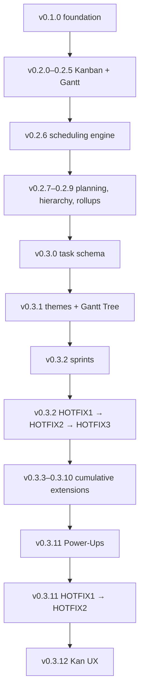

# Niyarvo Projects — complete release history (v0.1.0 → v0.3.12)

**Evidence standard:** Based on bundled `CHG-NP-*` release records, `docs/CHG-NP-0.2.6.md`, `docs/CHG-NP-0.2.9.md`, and v0.3.12 source. “Implemented” means present in the supplied source, **not** verified by physical-device QA, Git commit or deployment. Individual cumulative batches v0.3.3–v0.3.10 were **not** separately end-to-end tested or delivered as individually accepted releases.

## Release timeline

| Checkpoint | Functional changes actually described | Source / evidence / caveats |
|---|---|---|
| **v0.1.0** | Independent Expo React Native + Web application foundation; Niyarvo-branded responsive overview, project/task/release/test/schema/backups/activity/settings workflow; initial multi-project local state and JSON transfer. | `CHG-NP-0.1.0.md`; baseline persisted project/workspace model; no cloud integration. |
| **v0.2.0** | Local Kanban with PanResponder handles and ordered four lanes; task dependencies with cycle/blocker validation; basic status-triggered automations; timeline scheduling controls; URL attachment references; Android/Web import-export; recovery/corrupt-storage guard; release-readiness invariants; Niyarvo icon assets; deny-all Firebase scaffold. | `CHG-NP-0.2.0.md`; recorded 16 Node tests; runtime then unverified. |
| **v0.2.1** | Project picker separated from settings; create/manage/archive/restore project; mobile spacing/desktop breakpoint; Kanban horizontal edge auto-scroll; draggable/resizable timeline improvements. | `CHG-NP-0.2.1.md`; 25 tests at delivery. |
| **v0.2.2** | Full-card ~340ms long-press Kanban drag without separate handle; new independent React Native Gantt (`src/gantt.cjs`, `src/GanttView.js`) with bars, date ruler, move/resize, milestone diamonds, dependency connectors, unscheduled task rows and optional demo date population. | `CHG-NP-0.2.2.md`; preserve touch interactions. |
| **v0.2.3** | Direct Gantt dependency creation and critical-path estimate, validation against cycles and incorrect drop targets. | `CHG-NP-0.2.3.md`; FS/calendar-day analysis, not full typed critical path. |
| **v0.2.4** | Curved and more distinguishable SVG dependency lines, corrected link-preview coordinate handling, tap-to-select/remove link plus Links panel, intentional Unslop Gantt UI treatment; `react-native-svg` added. | `CHG-NP-0.2.4.md`; 58 tests; touch path device testing still necessary. |
| **v0.2.5** | Pinch/zoom and viewport pan math, controls and responsive layout refinements, Gantt interaction/scroll improvements, modular `src/design.cjs` and `src/viewport.cjs`. | `CHG-NP-0.2.5.md`; 66 tests. |
| **v0.2.6 / NP-SCHED1** | Independent pure scheduling engine with FS, SS, FF, SF link types, signed lag, working-day calendars and exceptions, audit/preview/cascade safety. **Engine-only checkpoint**; UI and persisted integration were *not* part of 0.2.6. | `docs/CHG-NP-0.2.6.md`, `CHG-NP-SCHED1.md`, `src/scheduling.cjs`. |
| **v0.2.7** | Integrated scheduling into project JSON, Timeline → Scheduling panel, typed-link editing, preview/confirm cascade, stale-preview rejection, recovery snapshots, downstream verification invalidation, automatic readiness downgrade; disabled unsupported legacy critical-path actions. | `CHG-NP-0.2.7.md`; 118 tests; native QA pending. |
| **v0.2.8** | Parent-child task hierarchy, cycle/depth validation, subtask creation, search/filter/bulk actions, bounded 40-row Tasks and progressive Kanban card loading. | `CHG-NP-0.2.8.md`; 133 tests. |
| **v0.2.9** | Task progress and estimated effort, leaf-weighted parent/project rollups, saved task views/filters/sorting, progress dashboard; complete source-based OpenProject capability survey. | `docs/CHG-NP-0.2.9.md`; 163 tests; this changelog is *not* at ZIP root. |
| **v0.3.0** | Per-project task types, custom fields (text/number/date/Boolean/select), optional status-transition enforcement, task configuration UI, delete safeguards and invalidation; safe-area providers for Android dialogs/root. | `CHG-NP-0.3.0.md`; 175 tests. Workflow enforcement defaults off. |
| **v0.3.1** | 10 named theme accents with Anthropic-style default orange `#D97757`, persisted separately; tintable monochrome Niyarvo brand; browser favicon theme; hierarchical Gantt Tree, collapsible subtasks, calculated read-only summary bars. | `CHG-NP-0.3.1.md`; 184 tests. |
| **v0.3.2** | Sprint planning per project: planned/active/completed, task assignments, one active sprint, goals/dates, recorded—not reconstructed—burndown, sprint finish/history/final scope, safe deletion of planned sprints. | `CHG-NP-0.3.2.md`; 196 tests. |
| **v0.3.2-HOTFIX1** | Added Android file-read helper and fallback after `FileSystemFile.text` READ permission errors on picked JSON. | `CHG-NP-0.3.2-HOTFIX1.md`; 207 tests. This did **not** resolve all user-observed import errors. |
| **v0.3.2-HOTFIX2** | Replaced Android import path with Expo FileSystem `File.pickFileAsync()` system-granted file handle; strict size/URI validation; keeps existing Web/iOS path. | `CHG-NP-0.3.2-HOTFIX2.md`; 216 tests. User subsequently **confirmed Atlas import worked**. |
| **v0.3.2-HOTFIX3** | Removed second Kanban embedded on Overview; Gantt visible row/day/path bounding & viewport-sized SVG for Atlas-sized projects; fewer initially mounted mobile board cards. | `CHG-NP-0.3.2-HOTFIX3.md`; 228 tests. User later showed Gantt and Web screenshots; no conclusive device profiling or universal native crash resolution evidence. |
| **v0.3.3** | Multi-project portfolio grouping and project health/completion/overdue/blockage summaries. | `CHG-NP-0.3.3.md`; included in cumulative 0.3.10, not separately device-accepted. |
| **v0.3.4** | Completed-sprint velocity/delivery reporting calculated from recorded sprint history. | `CHG-NP-0.3.4.md`; historic data limited to recorded events. |
| **v0.3.5** | Resource/contributor records with weekly availability and hourly rate; task time entries, logged hours and simple capacity alerts; rate snapshots. | `CHG-NP-0.3.5.md`; no actual resource leveling. |
| **v0.3.6** | Per-project budget/currency and labor cost metrics from time and rate entries; planned vs actual cost. | `CHG-NP-0.3.6.md`; not an accounting ledger. |
| **v0.3.7** | Local task comments and dated reminders. | `CHG-NP-0.3.7.md`; not real-time/team-push messaging. |
| **v0.3.8** | Tasks/time CSV exports with spreadsheet formula injection mitigation, reusable clean project template/duplicate with mapped task and dependency IDs, sprint report. | `CHG-NP-0.3.8.md`; CSV intentionally not full JSON. |
| **v0.3.9** | Multiple per-project named Kanban boards with protected Main board; task board assignment without status mutation; lanes top-aligned independently; fixed raw text/whitespace custom-field View error. | `CHG-NP-0.3.9.md`; 4 workflow statuses remain common to every board. |
| **v0.3.10** | Trello-inspired local advanced automation: multi-action rules, event/card/board buttons, manual due-date run, scoping and execution log; legacy rules retained. | `CHG-NP-0.3.10.md`; cumulative 264 tests; no unattended background scheduler. |
| **v0.3.11** | Per-board built-in Power-Ups: GitHub links and public previews, due date calendar, stale card aging, checklist progress; more compact cards and column add action. | `CHG-NP-0.3.11.md`; 278 tests; not Trello plugin runtime/GitHub OAuth. |
| **v0.3.11-HOTFIX1** | Scrollable bounded navigation links with persistent header/close and workspace picker; in-tree backdrop replacing nav modal; tap outside, Android Back and Web Escape dismissal. | `CHG-NP-0.3.11-HOTFIX1.md`; 283 tests; user later confirmed working both platforms. |
| **v0.3.11-HOTFIX2** | Dedicated browser-native `src/BrandMark.web.js` avoids `react-native-svg` WebShape crash for Niyarvo mark; Android/iOS SVG remains. | `CHG-NP-0.3.11-HOTFIX2.md`; 286 tests; **user confirmed Web and Android worked**. |
| **v0.3.12** | Kan-source-informed compact cards, labels/initials/due/check/attachments/GitHub metadata, advanced board filters (owner, priority, label, due dates), per-board description preference, card action menu, safe duplicate, move between statuses/boards, label add/remove. | `CHG-NP-0.3.12.md`; **297 tests**; v0.3.12 Android/Web interactions **not yet user-accepted**. |

## Release lineage (logical, not claimed Git history)

## Important release-truth distinctions

1. This is **source archive lineage**, not a real Git commit graph. No SHA is provided. User controls `work` → `main` acceptance and commits.
2. The first Android import hotfix was not sufficient. HOTFIX2 was the successful native-file-picker change; do not reapply HOTFIX1 alone.
3. The last explicitly user-confirmed fully navigable Web/Android **code baseline** is 0.3.11-HOTFIX2. 0.3.12 is the next QA candidate.
4. v0.2.6's engine did not include a UI; integration followed in v0.2.7. v0.2.9 and v0.2.6 release notes are in `docs/`.
5. v0.3.3–v0.3.10 are *logical feature batches within one cumulative delivered build*; do not assume independent tagged releases, independent CI or field acceptance.
6. Every archived `CHG-NP-*` reflects the original author's claims at its date, not a new independent audit. Current 0.3.12 test recheck and source read are documented in `06-AUDIT-AND-TRACEABILITY.md`.
