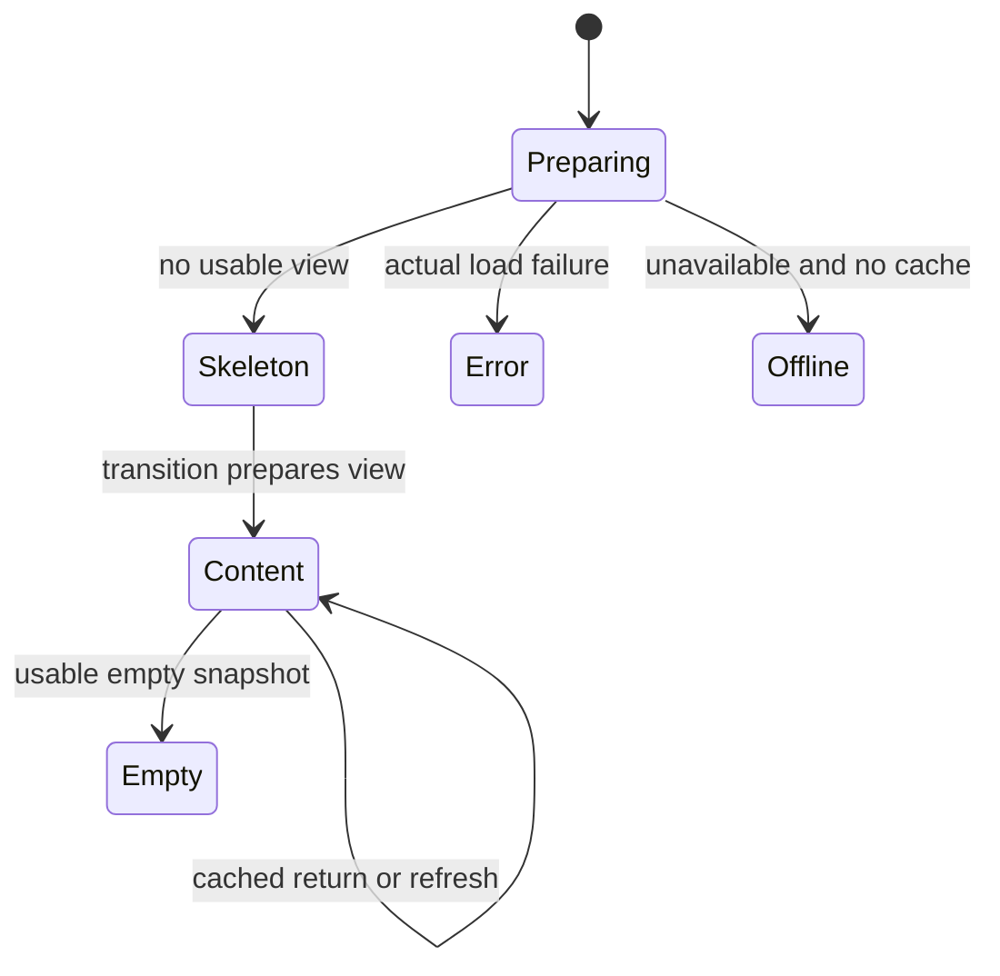

# 0.7.14 engineering report

The shared CachedPage first-visit text branch caused the flash; the four individual screens did not contain separate Preparing preview branches. Four bounded compositions now match 280/320-unit Board columns, 54-unit Timeline rows/52-unit calendar, dense Tasks rows and Sprint selector/summary/burndown/assignments. All use current theme surfaces. No task-dependent skeleton growth or hidden heavy measuring screen.

React transition scheduling replaces the forced two-frame native wait. Immediate content has no minimum skeleton hold. The real screen element stays memoized across hidden/active changes; placeholders only exist before preparation and receive active=false while hidden. Empty projects go straight to their real empty UI. Local workspace hydration and recovery errors remain handled by StoreProvider, with render errors in ScreenErrorBoundary.

The pure `screenReadiness.cjs` adapter supports later asynchronous snapshots without claiming an existing backend fetch. Cached data wins over loading/refresh/error flags; first errors/offline without cache are distinct from skeleton. No network/offline retry UI is invented for this local-only preparation flow.

One native Reanimated opacity animation runs on the UI thread for each visible skeleton; one WAAPI animation serves web. Both follow dynamic reduced-motion changes, remove listeners, cancel on hide/unmount and avoid per-frame React state. Shapes are accessibility-hidden and inert; a separate polite native live region/web status announces loading.

| Check | Result |
| --- | --- |
| Focused readiness/composition/retained-identity/motion cleanup | Pass — 5 tests; final composition/syntax follow-up also passes |
| Full npm test / source syntax | Pass — 884 tests, 0 failures; source parse/import-binding checks included |
| Native source/worklet transforms | Pass — motion surface and skeleton source; no build |
| Expo compatibility | Pass — dependencies up to date |
| Headless Chromium source screenshots | Pass — 8 phone light/dark compositions in source-review/overview.png; 10 responsive HTML fixtures. Static JSX, not app runtime |
| Live Web / Expo Go / Fast Refresh | Not run — user prohibits Expo start |
| Android frame gaps, controlled navigation p50/p95, hydration 100ms/1s/5s visual runtime | Not run — physical runtime unavailable/prohibited; deterministic pending/resolved/rejected promises tested |

No dependencies or data migration. Unslop attribution and before audit: PLAN.md. Latest user request prohibits builds/Expo servers; the agent's earlier development servers were stopped, the user's own Termux Metro is left alone. Separate 0.7.14 work commit is explicitly authorized; no push or merge. Update and rollback: `docs/instructions/release-0714.md`.
